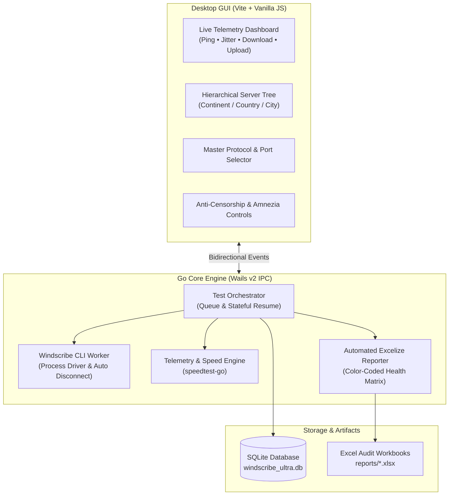

<p align="center">
  
  
  
  
  
  
  
</p>

<p align="center">
  <a href="README.md"><kbd>&nbsp; 🇬🇧 English &nbsp;</kbd></a>
  &nbsp;&nbsp;
  <a href="docs/README_FA.md"><kbd>&nbsp; 🇮🇷 پارسی &nbsp;</kbd></a>
  &nbsp;&nbsp;
  <a href="docs/README_RU.md"><kbd>&nbsp; 🇷🇺 Русский &nbsp;</kbd></a>
</p>

<h1 align="center">🌐 Windscribe Ultra Analyzer Pro</h1>

<p align="center">
  <b>Enterprise-Grade Automated Testing, Anti-Censorship Diagnostics & Quality Auditing Suite for Windscribe VPN</b>
</p>

<p align="center">
  Windscribe Ultra Analyzer Pro is a high-performance desktop application designed to systematically benchmark, diagnose, and audit Windscribe VPN server nodes across restrictive networks and Deep Packet Inspection (DPI) environments, with dedicated optimization for **Iran** (National Information Network filtering) and **Russia** (TSPU / RKN blockades). Built with <b>Go</b> and <b>Wails v2</b>, it orchestrates the native Windscribe CLI to evaluate protocol resilience, capture live telemetry (Ping, Jitter, Download, Upload), and automatically generate professional, color-coded Excel audit sheets.
</p>

---

## 🏗️ Architecture



---

## ✨ Features

- **Multi-Location Tree Hierarchy & Online Sync**:
  - Interactive global tree organizing hundreds of server nodes by **Continent → Country / Region → Server Location**.
  - Real-time fuzzy searching across continents, countries, cities, and server aliases with auto-expansion.
  - Cascading multi-select controls with parent indeterminate state support.
  - Live online sync directly from official Windscribe APIs with automatic fallback to local snapshots.
  - Selection Modes: `Manual Select`, `Smart (Data-Driven)`, and `Discovery` (5 random servers).

- **Exhaustive Multi-Protocol & Port Scanning**:
  - Full matrix scanning covering:
    - **WireGuard**: `443`, `80`, `53`, `123`, `1194`, `65142`
    - **OpenVPN UDP**: `443`, `80`, `53`, `123`, `1194`, `54783`
    - **OpenVPN TCP**: `443`, `587`, `21`, `22`, `80`, `123`, `143`, `3306`, `8080`, `54783`, `1194`
    - **Stealth (Stunnel)**: `443`, `587`, `21`, `22`, `80`, `123`, `143`, `3306`, `8080`, `54783`, `8443`
    - **WStunnel (WebSocket)**: `443`
    - **IKEv2**: `500`
  - Unified master selector with live count badge (`X Protos, Y Ports`).

- **Anti-Censorship & Amnezia Engine Injection**:
  - **Live Engine Parameter Injection**: Unlike basic metadata logging, the analyzer directly synchronizes and injects your selected settings into Windscribe's core engine:
    - **Amnezia Presets (A through J)**: Decrypts and injects `AmneziawgPreset` directly into Windscribe's Qt `SimpleCrypt` engine storage:
      - **Iran Profiles**: `J - Iran Junk Packets`, `I - UAE and Iran Legacy`, `H - Iran 26 May 2026`.
      - **Russia Profiles**: `A - No Junk Russia Primary`, `B - No Junk Russia Alt`, `C - With Junk Russia Primary`, `D - With Junk Russia Alt`, `G - Popular Russia Website with Junk`.
      - **General Baseline**: `E - Baseline No Junk`, `F - Baseline With Junk`.
    - **Custom SNI Domain**: Injects `CustomSniDomain` for Stealth and WStunnel protocols to customize TLS SNI headers for deep packet inspection evasion.
    - **Server Routing**: Dynamically toggles `ServerRoutingMethod` between `Auto` (0), `Regular` (1), and `Alternate` (2).
    - **Large TLS Padding**: Injects `ws-stealth-extra-tls-padding` into Windscribe's `windscribe_extra.conf`, dynamically recognized via Windscribe's real-time `FileChangeWatcher`.
  - **Verification in Windscribe Logs**: You can inspect `%LOCALAPPDATA%\Windscribe\Windscribe2\client.log` (Windows) or `~/.config/Windscribe/client.log` (Linux) to verify live injection:
    ```json
    {"mod": "conn", "msg": "Using protocol tweaks, preset: \"J - Iran Junk Packets\""}
    {"mod": "conn", "msg": "Added 5 I-parameters to OpenVPN config from preset: \"J - Iran Junk Packets\""}
    ```

- **Country & Operator (ISP) Benchmark Tagging**:
  - Tag test batches by country and network provider to analyze operator-specific DPI throttling:
    - **Iran Operators**: `MCI`, `Irancell`, `Rightel`, `Mokhaberat (TCI)`, `Shatel`, `Asiatech`, `Mobinnet`, `Zitel`, `HiWeb`, `Pars Online`, `Pishgaman`, `Fanava`, `Other / Direct`.
    - **Russia Operators**: `Rostelecom`, `MTS`, `Beeline`, `MegaFon`, `Tele2`, `ER-Telecom (Dom.ru)`, `NetByNet`, `Other / Direct`.
    - **China & Global**: Pre-populated profiles for China Telecom/Unicom/Mobile, Starlink, Direct/LAN.
    - **Dynamic Custom Additions**: Users can add any custom country or custom ISP/operator directly through the UI, stored persistently.
  - Selected Country and ISP are stamped across historical database records and included in Column C of Excel audit files.

- **Live Telemetry & Dashboard**:
  - Decoupled modern stat cards with dedicated color-coded badges:
    - **⚡ PING / JITTER**: Millisecond-accurate RTT and jitter latency.
    - **⬇️ DOWNLOAD**: Multi-stream bandwidth in Mbps.
    - **⬆️ UPLOAD**: Transfer rate in Mbps.
    - **📡 STATUS**: Live phase tracking (`Connecting`, `Testing Ping...`, `Testing Speed...`, `Disconnecting`, `Done`, `Idle`).
  - Real-time console log with timestamps, log levels, and auto-scroll control.

- **Automated Color-Coded Excel Quality Reports**:
  - Generates `.xlsx` audit workbooks upon test completion or user pause.
  - **Traffic Light Grading**:
    - 🟢 **Green (Healthy)**: Fast throughput (> 10 Mbps) and low latency (< 150 ms).
    - 🟡 **Yellow (Suboptimal)**: Connected with throttled speed or high jitter.
    - 🔴 **Red (Failed / Blocked)**: Connection timeout, dropped handshake, or zero throughput.
  - Floating toast notification with direct `Open File` action and top header shortcut button.

- **Stateful Session Pause & Resume**:
  - Clicking **STOP** immediately halts testing, disconnects Windscribe, and saves all completed results.
  - Retains queue progress and shows remaining count (`CONTINUE TEST (N LEFT)`) to resume anytime.

- **Embedded SQLite Storage**:
  - Automatically maintains `windscribe_ultra.db` with schema migrations and legacy data sanitization.

---

## 💻 System Requirements

- **Operating Systems**:
  - **Windows**: Windows 10 / 11 (64-bit)
  - **macOS**: macOS 11+ Big Sur, Monterey, Ventura, Sonoma, Sequoia (Universal: Intel & Apple Silicon M1/M2/M3/M4)
  - **Linux**: Ubuntu 20.04+, Debian 11+, Fedora, Arch Linux, etc.
- **Windscribe Client**: Official Windscribe Desktop client installed (native `windscribe-cli` is utilized)
- **Webview Runtime**:
  - Windows: Microsoft Edge WebView2 (built-in on Windows 10/11)
  - macOS: WebKit (built-in macOS Cocoa runtime)
  - Linux: `libwebkit2gtk-4.0` / `libwebkit2gtk-4.1`

---

## 🚀 Installation & Quick Start

### 🪟 Install via Windows Package Manager (Winget) *(Coming Soon)*

> [!NOTE]
> *(Coming Soon)* The package has been submitted to the official Windows Package Manager repository and is currently undergoing final Microsoft moderation. Once merged, you can install and update directly via:

```powershell
winget install AminDenizer.WindscribeUltraAnalyzer
```

---

### ⚡ 1-Line PowerShell Quick Launch (Windows)

Open **PowerShell** and paste the command below to automatically download, unblock, and launch the latest version without installation:

```powershell
irm https://github.com/AminDenizer/Windscribe-Analyzer/releases/latest/download/windscribe-ultra-tester.exe -OutFile windscribe-ultra-tester.exe; Unblock-File .\windscribe-ultra-tester.exe; .\windscribe-ultra-tester.exe
```

---

### 📦 Manual Download & Installation

1. Go to the [Releases](../../releases/latest) section and download the package for your platform:
   - **Windows**: `windscribe-ultra-tester.exe` (or `windscribe-ultra-tester-windows-amd64.zip`)
   - **macOS**: `windscribe-ultra-tester-macos-universal.zip` (extract `windscribe-ultra-tester.app` and launch)
   - **Linux**: `windscribe-ultra-tester-linux-amd64.tar.gz` (extract and run `./windscribe-ultra-tester`)
2. Ensure the official **Windscribe desktop client** is installed on your machine.
3. Launch the application. No complex installation or setup is needed!

> [!TIP]
> **Windows SmartScreen Note**:  
> Because this is a newly released, open-source binary built via GitHub Actions, Windows Defender SmartScreen may display an *"Unknown publisher"* prompt when downloaded via web browsers.
> - **1-Line PowerShell**: Run the snippet above (bypasses browser Mark-of-the-Web flags).
> - **1-Click Batch**: Run `run_without_smartscreen.bat` included in the zip distribution.
> - **Or via Dialog**: Click **"More info"** on the Windows SmartScreen alert, then click **"Run anyway"**.

---

## 📖 Usage Workflow

1. **Select Network Country & ISP**: Choose your current location (**Iran**, **Russia**, etc.) and corresponding provider, or add a custom country/operator if not listed.
2. **Configure Anti-Censorship**:
   - Enable **Protocol Tweaks**.
   - Select an **Amnezia Config** preset (e.g. `J - Iran Junk Packets`).
   - Select **Server Routing** (`Regular`, `Auto`, or `Alternate`).
   - Optionally toggle **Large TLS Padding**.
   - If testing Stealth or WStunnel, customize the **Custom SNI Domain** as needed.
3. **Select Protocols & Ports**:
   - Use the master checkbox to select all or pick specific protocols and ports.
4. **Choose Server Locations**:
   - Search countries or cities, click `All`, or check individual servers in the tree.
5. **Configure Timeouts**:
   - **Connect Timeout**: Maximum seconds to wait for connection (default: `25s`).
   - **Wait Speed**: Settling delay before speedtest starts (default: `3s`).
6. **Start Testing**:
   - Click **START ANALYZING**.
   - Monitor live ping, jitter, download, and upload speeds.
   - Click **STOP** to pause; click **CONTINUE TEST** to resume.
7. **View Results**:
   - Open the automatically generated Excel file from the floating toast or top header button.

---

## 📊 Excel Report Structure

Exported workbooks in `reports/` contain full session audit details:
- **Columns**: Timestamp, Country, ISP / Operator, Location, Protocol, Port, SNI Domain, Amnezia Config, Server Routing, Large TLS, Connect Time (s), Ping (ms), Jitter (ms), Download (Mbps), Upload (Mbps), Status.
- **Conditional Highlighting**: Color-coded rows (Green, Yellow, Red) based on latency and throughput thresholds.

---

## 🛠️ Building from Source

### Prerequisites
- **Go** 1.24+ ([Download Go](https://go.dev/dl/))
- **Node.js** 20+ & **npm** ([Download Node.js](https://nodejs.org/))
- **Wails CLI v2**:
  ```powershell
  go install github.com/wailsapp/wails/v2/cmd/wails@latest
  ```

### Build Steps
```powershell
# Clone the repository
git clone https://github.com/your-username/windscribe-ultra-analyzer.git
cd windscribe-ultra-analyzer

# Install frontend dependencies
cd frontend
npm install
cd ..

# Build production executable for Windows x64
wails build -platform windows/amd64
```
Output binary: `build/bin/windscribe-ultra-tester.exe`

---

## ❓ FAQ

- **How does the tool communicate with Windscribe?**  
  It controls the native `windscribe-cli.exe` binary directly via non-blocking background worker processes.
- **Why is Custom SNI enabled only for Stealth and WStunnel?**  
  SNI domain fronting is an obfuscation feature specific to TLS-wrapped protocols (Stealth and WStunnel).
- **Does it require administrative privileges?**  
  Standard user privileges are sufficient. If your Windows TAP/Wintun adapter requires elevation, run as Administrator.

---

## ⚠️ Legal & Usage Disclaimer

**Please read this disclaimer carefully before using this software:**

1. **Independent Project**: This application is an **unofficial, community-developed, open-source utility**. It is **NOT** affiliated with, endorsed by, sponsored by, or certified by **Windscribe Limited**, its parent company, or its subsidiaries.
2. **"AS IS" & No Warranty**: This software is provided *"as is"* and *"as available"*, without any warranties or guarantees of any kind, whether express, statutory, or implied, including, without limitation, any warranties of merchantability, fitness for a particular purpose, non-infringement, reliability, or uninterrupted operation.
3. **User Responsibility & Assumption of Risk**: 
   - Use of this software is entirely at your own discretion and risk. 
   - You are solely responsible for compliance with Windscribe's Terms of Service, Acceptable Use Policies, and all applicable local and international laws and regulations.
   - The authors, contributors, and maintainers of this project accept **no liability or responsibility** for any account bans, suspensions, bandwidth consumption, data overage charges, ISP actions, system freezes, network disconnections, or any direct, indirect, incidental, special, or consequential damages resulting from the use or inability to use this software.

---

## 📄 License

This project is licensed under the **MIT License** - see the [LICENSE](LICENSE) file for details.
