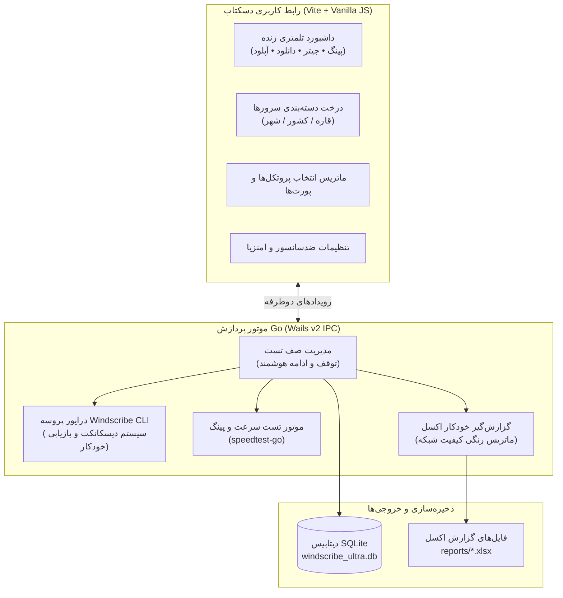

<p align="center">
  
  
  
  
  
  
  
</p>

<p align="center">
  <a href="../README.md"><kbd>&nbsp; 🇬🇧 English &nbsp;</kbd></a>
  &nbsp;&nbsp;
  <a href="README_FA.md"><kbd>&nbsp; 🇮🇷 پارسی &nbsp;</kbd></a>
  &nbsp;&nbsp;
  <a href="README_RU.md"><kbd>&nbsp; 🇷🇺 Русский &nbsp;</kbd></a>
</p>

<h1 align="center" dir="rtl">🌐 واینداسکرایب اولترا آنالایزر پرو (Windscribe Ultra Analyzer Pro)</h1>

<p align="center" dir="rtl">
  <b>مجموعه پیشرفته بنچمارک خودکار، تست دور زدن فیلترینگ و سنجش کیفیت سرورهای واینداسکرایب</b>
</p>

<div dir="rtl">

برنامه **Windscribe Ultra Analyzer Pro** یک نرم‌افزار دسکتاپ مدرن و پرسرعت است که به طور اختصاصی برای تست سیستماتیک، عیب‌یابی و سنجش عملکرد سرورهای Windscribe VPN در شرایط فیلترینگ شدید و سیستم‌های بازرسی عمیق بسته‌ها (DPI) طراحی شده است. این ابزار بهینه‌سازی ویژه‌ای برای شبکه‌های **ایران** (فیلترینگ شبکه ملی اطلاعات و اختلالات پروتکل‌ها) و **روسیه** (سیستم‌های TSPU / RKN) دارد.

این نرم‌افزار با زبان **Go** و فریم‌ورک **Wails v2** توسعه یافته و با کنترل مستقیم هسته و رابط خط فرمان بومی واینداسکرایب (`windscribe-cli`)، مقاومت پروتکل‌ها را می‌سنجد، اطلاعات تلمتری زنده (پینگ، جیتر، سرعت دانلود و آپلود) را ثبت می‌کند و به صورت خودکار گزارش‌های دقیق و رنگ‌بندی‌شده در قالب اکسل تولید می‌نماید.

---

## 🏗️ معماری نرم‌افزار



---

## ✨ امکانات و قابلیت‌های کلیدی

### ۱. تزریق زنده تنظیمات ضدسانسور به انجین واینداسکرایب
برخلاف ابزارهای نمایشی، این تستر تنظیمات را مستقیماً به انجین و حافظه رجیستری واینداسکرایب تزریق می‌کند:
- **پریست‌های امنزیا (Amnezia Presets A تا J):** تزریق مستقیم به تنظیمات رمزنگاری‌شده `SimpleCrypt` واینداسکرایب:
  - **پروفایل‌های مخصوص ایران:** `J - Iran Junk Packets`، `I - UAE and Iran Legacy`، `H - Iran 26 May 2026`.
  - **پروفایل‌های مخصوص روسیه:** `A - No Junk Russia Primary`، `B - No Junk Russia Alt`، `C - With Junk Russia Primary`، `D - With Junk Russia Alt`، `G - Popular Russia Website with Junk`.
  - **پروفایل‌های عمومی:** `E - Baseline No Junk`، `F - Baseline With Junk`.
- **آدرس دامنه اختصاصی (Custom SNI Domain):** تنظیم و تزریق مستقیم آدرس‌های سفارشی SNI برای پروتکل‌های Stealth و WStunnel جهت تغییر هدرهای TLS و دور زدن فیلترینگ.
- **مسیریابی سرورها (Server Routing):** سوئیچ هوشمند بین حالت‌های `Auto` (خودکار)، `Regular` (عادی) و `Alternate` (جایگزین).
- **پدینگ سایز بزرگ (Large TLS Padding):** فعال‌سازی یا غیرفعال‌سازی پارامتر `ws-stealth-extra-tls-padding` در فایل تنظیمات واینداسکرایب با اعمال لحظه‌ای.
- **تزریق DNS داخلی (App Internal DNS):** امکان ست کردن DNS دلخواه (Cloudflare, Google, ControlD, OpenDNS, OS Default) بر روی کلاینت واینداسکرایب.

### ۲. پایش و اسکن جامع پورت‌ها و پروتکل‌ها
پشتیبانی کامل از تمامی پروتکل‌های واینداسکرایب همراه با پورت‌های متعدد:
- **WireGuard:** پورت‌های `443`, `80`, `53`, `123`, `1194`, `65142`
- **OpenVPN UDP:** پورت‌های `443`, `80`, `53`, `123`, `1194`, `54783`
- **OpenVPN TCP:** پورت‌های `443`, `587`, `21`, `22`, `80`, `123`, `143`, `3306`, `8080`, `54783`, `1194`
- **Stealth (Stunnel):** پورت‌های `443`, `587`, `21`, `22`, `80`, `123`, `143`, `3306`, `8080`, `54783`, `8443`
- **WStunnel (WebSocket):** پورت `443`
- **IKEv2:** پورت `500` (در ویندوز و مک؛ با پنهان‌سازی خودکار در لینوکس به دلیل عدم پشتیبانی بومی)

### ۳. سیستم بازیابی ۲ مرحله‌ای و واچ‌داگ ضد قفل (Anti-Freeze Watchdog)
- مجهز به تایم‌اوت ۱۰ ثانیه‌ای قطعی روی تمامی ارتباطات CLI تا هیچ دستوری برنامه را معلق نکند.
- **آزادسازی خودکار پروسه‌های زامبی:** در صورت بروز تایم‌اوت، پروسه‌های پس‌زمینه گیرکرده (مثل `windscribewstunnel.exe` یا OpenVPN) به طور خودکار بسته می‌شوند تا سوکت و آداپتور Wintun قفل نمانند.
- **سوپاپ اطمینان ریستارت خودکار:** در صورتی که کلاینت دچار بن‌بست داخلی شود، تستر کلاینت را در ۲ ثانیه ریستارت تمیز می‌کند تا بدون نیاز به تسک‌منیجر، تست لوکیشن بعدی آغاز شود.

### ۴. تفکیک و برچسب‌گذاری بر اساس کشور و اپراتور (ISP)
- برچسب‌گذاری صف تست با نام اپراتور اینترنت جهت شناسایی دقیق رفتار DPI هر ارائه‌دهنده:
  - **اپراتورهای ایران:** همراه اول (MCI)، ایرانسل (Irancell)، رایتل (Rightel)، مخابرات (TCI)، شاتل، آسیاتک، مبین‌نت، زیتل، های‌وب، پارس‌آنلاین، پیشگامان، فن‌آوا و ...
  - **اپراتورهای روسیه:** Rostelecom, MTS, Beeline, MegaFon, Tele2, Dom.ru و ...
  - **قابلیت افزودن اپراتور و کشور دلخواه:** امکان تایپ و ذخیره اپراتورهای جدید مستقیماً از داخل برنامه.

### ۵. گزارش‌گیری خودکار در قالب اکسل (Excel Reports)
- تولید خودکار فایل گزارش `.xlsx` در پایان تست یا هنگام توقف موقت.
- **رنگ‌بندی هوشمند بر اساس چراغ راهنما:**
  - 🟢 **سبز (سالم و پایدار):** سرعت بالای ۱۰ مگابیت و پینگ کمتر از ۱۵۰ میلی‌ثانیه.
  - 🟡 **زرد (نیمه‌مختل یا کند):** اتصال برقرار شده با سرعت پایین یا جیتر بالا.
  - 🔴 **قرمز (مسدود یا ناموفق):** تایم‌اوت، عدم اتصال، یا پهنای باند صفر.

---

## 💻 پیش‌نیازهای سیستم

- **سیستم‌های عامل پشتیبانی‌شده:**
  - **ویندوز:** Windows 10 / 11 (نسخه ۶۴ بیتی)
  - **مک:** macOS 11+ (پشتیبانی یکپارچه Universal از پردازنده‌های اینتل و اپل سیلیکون M1/M2/M3/M4)
  - **لینوکس:** Ubuntu 20.04+, Debian 11+, Fedora, Arch Linux و سایر توزیع‌ها
- **کلاینت واینداسکرایب:** نسخه رسمی دسکتاپ واینداسکرایب باید روی سیستم نصب باشد.

---

## 🚀 راهنمای نصب و اجرای سریع

### 🪟 نصب مستقیم با ابزار رسمی ویندوز (Winget) — *(به‌زودی)*

> [!NOTE]
> *(به‌زودی)* پکیج رسمی برنامه به مخزن مایکروسافت ارسال شده و در صف تایید نهایی قرار دارد. پس از تایید نهایی، می‌توانید مستقیماً با دستور زیر آن را نصب و آپدیت کنید:

```powershell
winget install AminDenizer.WindscribeUltraAnalyzer
```

---

### ⚡ اجرای تک‌خطی بدون نیاز به دانلود دستی در پاورشل (ویندوز)

کافیست نرم‌افزار **PowerShell** ویندوز را باز کرده و دستور زیر را در آن پیست کنید تا آخرین نسخه دانلود، قفل‌زدایی و اجرا شود:

```powershell
irm https://github.com/AminDenizer/Windscribe-Analyzer/releases/latest/download/windscribe-ultra-tester.exe -OutFile windscribe-ultra-tester.exe; Unblock-File .\windscribe-ultra-tester.exe; .\windscribe-ultra-tester.exe
```

---

### 📦 دانلود دستی بسته‌ها

۱. به بخش [Releases](../../releases/latest) بروید و بسته مخصوص سیستم‌عامل خود را دانلود کنید:
   - **ویندوز:** `windscribe-ultra-tester.exe` (یا فایل فشرده زیپ)
   - **مک:** `windscribe-ultra-tester-macos-universal.zip`
   - **لینوکس:** `windscribe-ultra-tester-linux-amd64.tar.gz`
۲. فایل را اجرا کنید. نیازی به هیچ‌گونه نصب یا مراحل پیچیده نیست!

> [!TIP]
> **نکته درباره پیام SmartScreen ویندوز:**  
> به دلیل اینکه این نرم‌افزار متن‌باز است و امضای دیجیتال گران‌قیمت تجاری ندارد، ممکن است مرورگر یا اسمارت‌اسکرین پیامی نمایش دهد:
> - **روش تک‌خطی پاورشل:** دستور بالا را بزنید (به دلیل دانلود مستقیم از ترمینال، پیام اسمارت‌اسکرین ظاهر نمی‌شود).
> - **روش فایل Bat:** اگر فایل زیپ را دانلود کرده‌اید، فایل `run_without_smartscreen.bat` را اجرا کنید.
> - **روش دستی:** در پنجره اسمارت‌اسکرین روی **More info** و سپس **Run anyway** کلیک کنید.

---

## 📖 مراحل انجام تست

۱. **کشور و اپراتور** اینترنت خود را انتخاب کنید (مثلاً ایران - همراه اول).
۲. **تنظیمات دور زدن فیلترینگ** را در صورت تمایل فعال کنید (مثلاً تیک Protocol Tweaks و پریست `J - Iran Junk Packets` یا تغییر دامنه SNI).
۳. **پروتکل‌ها و پورت‌ها** را علامت بزنید (مثلاً فقط WStunnel روی پورت ۴۴۳).
۴. **سرورها** را از روی لیست درختی انتخاب کنید.
۵. روی دکمه **START ANALYZING** کلیک کنید.
۶. روند تست زنده را مشاهده کنید و در صورت نیاز با زدن **STOP** آن را متوقف و سپس **CONTINUE** کنید.
۷. در پایان فایل اکسل گزارش را با زدن دکمه اکسل باز کرده و وضعیت سرورها را مشاهده کنید.

---

## ⚠️ سلب مسئولیت قانونی و شرایط استفاده

**لطفاً قبل از استفاده از این نرم‌افزار متن زیر را با دقت مطالعه فرمایید:**

۱. **پروژه مستقل و غیررسمی:** این نرم‌افزار یک ابزار **کاملاً مستقل، جامعه‌محور و متن‌باز** است و به هیچ عنوان به شرکت **Windscribe Limited** یا شرکت‌های وابسته به آن وابسته نبوده و توسط آن‌ها تایید یا پشتیبانی نمی‌شود.
۲. **ارائه به صورت "همان‌گونه که هست" (AS IS):** این نرم‌افزار بدون هیچ‌گونه ضمانت صریح، ضمنی یا قانونی ارائه می‌گردد و هیچ تعهدی در خصوص عدم وقفه، پایداری دائم یا تناسب با هدف خاص داده نمی‌شود.
۳. **مسئولیت کامل کاربر (Assumption of Risk):**
   - استفاده از این نرم‌افزار کاملاً با تصمیم و مسئولیت شخصی خود کاربر صورت می‌پذیرد.
   - کاربر موظف است قوانین محلی، شرایط استفاده از خدمات واینداسکرایب و سیاست‌های ارائه‌دهنده اینترنت خود را رعایت نماید.
   - توسعه‌دهندگان، مشارکت‌کنندگان و مدیران این پروژه **هیچ‌گونه مسئولیتی** در قبال محدودیت حساب کاربری، مسدودی، مصرف حجم دیتا، هزینه‌های اینترنت، مسدودسازی آی‌پی توسط اپراتورها، یا هرگونه خسارت مستقیم و غیرمستقیم ناشی از استفاده از این نرم‌افزار بر عهده نخواهند داشت.

---

## 📄 مجوز انتشار (License)

این پروژه تحت مجوز **MIT License** منتشر شده است. برای اطلاعات بیشتر فایل [LICENSE](../LICENSE) را مطالعه کنید.

</div>
