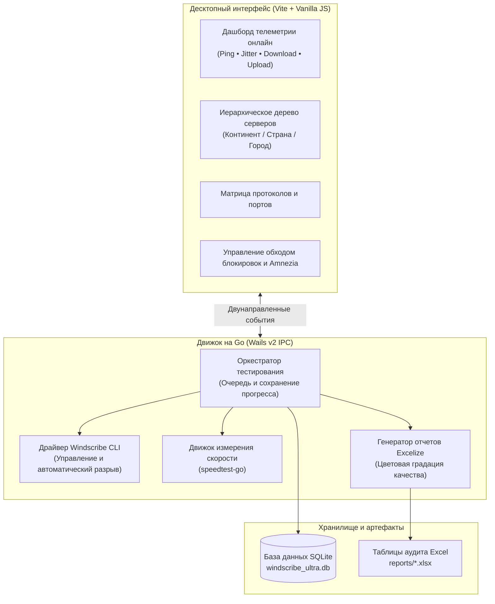

<p align="center">
  
  
  
  
  
  
  
</p>

<p align="center">
  <a href="../README.md"><kbd>&nbsp; 🇬🇧 English &nbsp;</kbd></a>
  &nbsp;&nbsp;
  <a href="README_FA.md"><kbd>&nbsp; 🇮🇷 پارسی &nbsp;</kbd></a>
  &nbsp;&nbsp;
  <a href="README_RU.md"><kbd>&nbsp; 🇷🇺 Русский &nbsp;</kbd></a>
</p>

<h1 align="center">🌐 Windscribe Ultra Analyzer Pro</h1>

<p align="center">
  <b>Профессиональный комплекс автоматизированного тестирования, обхода цензуры и аудита качества Windscribe VPN</b>
</p>

<p align="center">
  <b>Windscribe Ultra Analyzer Pro</b> — это высокопроизводительное настольное приложение, созданное для систематического бенчмаркинга, диагностики и проверки доступности серверных локаций Windscribe VPN в условиях жесткой цензуры и глубокого анализа пакетов (DPI). Программа содержит специализированные оптимизации для сетей <b>России</b> (блокировки РКН и фильтрация ТСПУ) и <b>Ирана</b> (ограничения Национальной информационной сети). Разработанный на <b>Go</b> и <b>Wails v2</b>, анализатор управляет нативным CLI-движком Windscribe, тестирует устойчивость протоколов, собирает детальную телеметрию в реальном времени (Ping, Jitter, Download, Upload) и автоматически формирует наглядные таблицы аудита в формате Excel.
</p>

---

## 🏗️ Архитектура



---

## ✨ Ключевые возможности

### 1. Прямая инъекция параметров обхода блокировок в движок Windscribe
В отличие от простых средств логирования, утилита синхронизирует и напрямую внедряет выбранные настройки в конфигурацию движка Windscribe:
- **Пресеты Amnezia (от A до J):** Дешифрует и инжектирует значение `AmneziawgPreset` напрямую в защищенное хранилище настроек Windscribe (`SimpleCrypt`):
  - **Профили для России:** `A - No Junk Russia Primary`, `B - No Junk Russia Alt`, `C - With Junk Russia Primary`, `D - With Junk Russia Alt`, `G - Popular Russia Website with Junk`.
  - **Профили для Ирана:** `J - Iran Junk Packets`, `I - UAE and Iran Legacy`, `H - Iran 26 May 2026`.
  - **Базовые универсальные профили:** `E - Baseline No Junk`, `F - Baseline With Junk`.
- **Пользовательский домен SNI (Custom SNI Domain):** Задание собственного SNI для протоколов Stealth и WStunnel (позволяет маскировать соединения под разрешенные домены).
- **Маршрутизация серверов (Server Routing):** Переключение режимов маршрутизации между `Auto` (0), `Regular` (1) и `Alternate` (2).
- **Увеличенный TLS-паддинг (Large TLS Padding):** Динамическое управление параметром `ws-stealth-extra-tls-padding` в `windscribe_extra.conf`.
- **Внутренний DNS (App Internal DNS):** Установка политики DNS (Cloudflare, Google, ControlD, OpenDNS, OS Default) непосредственно в приложении Windscribe.

### 2. Полное сканирование протоколов и портов
Поддержка исчерпывающей матрицы протоколов и портов:
- **WireGuard:** `443`, `80`, `53`, `123`, `1194`, `65142`
- **OpenVPN UDP:** `443`, `80`, `53`, `123`, `1194`, `54783`
- **OpenVPN TCP:** `443`, `587`, `21`, `22`, `80`, `123`, `143`, `3306`, `8080`, `54783`, `1194`
- **Stealth (Stunnel):** `443`, `587`, `21`, `22`, `80`, `123`, `143`, `3306`, `8080`, `54783`, `8443`
- **WStunnel (WebSocket):** `443`
- **IKEv2:** `500` (для Windows и macOS; в Linux скрывается автоматически ввиду отсутствия нативной поддержки в CLI).

### 3. Двухуровневая система защиты от зависаний (2-Tier Anti-Freeze Watchdog)
- Установлен строгий 10-секундный лимит ожидания для каждой команды CLI — интерфейс никогда не зависает.
- **Очистка зомби-процессов:** Если при разрыве соединения туннель завис, утилита принудительно завершает зависшие дочерние процессы (`windscribewstunnel.exe`, `windscribeopenvpn.exe`), мгновенно освобождая виртуальный сетевой адаптер Wintun и порты.
- **Автоматический мягкий перезапуск:** В случае внутреннего сбоя стейт-машины Windscribe, приложение автоматически перезапускает клиент за 2 секунды, исключая необходимость завершать задачи через Диспетчер задач вручную.

### 4. Тегирование по странам и интернет-провайдерам (ISP)
- Анализ поведения DPI под конкретного оператора связи:
  - **Провайдеры РФ:** Ростелеком, МТС, Билайн, МегаФон, Tele2, ЭР-Телеком (Дом.ру), NetByNet и др.
  - **Провайдеры Ирана:** MCI, Irancell, Rightel, TCI, Shatel, Asiatech, Mobinnet и др.
  - **Возможность добавления:** Пользователь может прямо в интерфейсе вписать любого нового провайдера или страну.

### 5. Автоматические отчеты Excel с цветовой градацией
- Генерация файла `.xlsx` по окончании теста или при нажатии кнопки паузы.
- **Цветовая схема «Светофор»:**
  - 🟢 **Зеленый (Отлично):** Скорость выше 10 Мбит/с и пинг менее 150 мс.
  - 🟡 **Желтый (Замедление):** Соединение установлено, но скорость ограничена или высокий джиттер.
  - 🔴 **Красный (Блокировка / Ошибка):** Таймаут рукопожатия, потеря пакетов или нулевая пропускная способность.

---

## 💻 Системные требования

- **Операционные системы:**
  - **Windows:** Windows 10 / 11 (64-бит)
  - **macOS:** macOS 11+ Big Sur, Monterey, Ventura, Sonoma, Sequoia (Universal: Intel и Apple Silicon M1/M2/M3/M4)
  - **Linux:** Ubuntu 20.04+, Debian 11+, Fedora, Arch Linux и др.
- **Клиент Windscribe:** Установленный официальный десктопный клиент Windscribe (используется встроенный `windscribe-cli`).

---

## 🚀 Установка и быстрый старт

### ⚡ Быстрый запуск одной строкой в PowerShell (Windows)

Откройте **PowerShell** и вставьте следующую команду, чтобы автоматически скачать, снять блокировку SmartScreen и запустить приложение:

```powershell
irm https://github.com/AminDenizer/Windscribe-Analyzer/releases/latest/download/windscribe-ultra-tester.exe -OutFile windscribe-ultra-tester.exe; Unblock-File .\windscribe-ultra-tester.exe; .\windscribe-ultra-tester.exe
```

---

### 📦 Ручная загрузка

1. Перейдите в раздел [Releases](../../releases/latest) и скачайте файл для вашей ОС:
   - **Windows:** `windscribe-ultra-tester.exe` (или zip-архив)
   - **macOS:** `windscribe-ultra-tester-macos-universal.zip`
   - **Linux:** `windscribe-ultra-tester-linux-amd64.tar.gz`
2. Запустите приложение. Никакой предварительной настройки или сложной установки не требуется!

> [!TIP]
> **О предупреждении Windows SmartScreen:**  
> Поскольку это открытый исходный код без дорогостоящего коммерческого сертификата подписи, браузер или Windows Defender может показать предупреждение:
> - **Запуск через PowerShell:** Команда выше скачивает файл через терминал, минуя системные метки браузера Mark-of-the-Web.
> - **Запуск через bat-файл:** Если вы скачали zip-архив, просто запустите `run_without_smartscreen.bat`.
> - **В окне предупреждения:** Нажмите **«Подробнее»** (More info) → **«Выполнить в любом случае»** (Run anyway).

---

## 📖 Порядок использования

1. **Выберите страну и провайдера** (например, Россия — Ростелеком или МТС).
2. **Включите параметры обхода блокировок** (например, галочка `Protocol Tweaks`, пресет Amnezia `A` или `G`, либо укажите свой SNI).
3. **Отметьте протоколы и порты** (например, WStunnel:443 или WireGuard).
4. **Выберите интересующие локации** в дереве серверов.
5. Нажмите кнопку **START ANALYZING**.
6. Следите за процессом в онлайн-дашборде (в любой момент можно нажать **STOP**, а затем **CONTINUE**).
7. По окончании откройте сгенерированный Excel-файл и выберите наиболее быстрые и стабильные серверы.

---

## ⚠️ Юридический дисклеймер (Отказ от ответственности)

**Пожалуйста, внимательно ознакомьтесь с данным отказом от ответственности перед использованием программы:**

1. **Независимый проект:** Данное программное обеспечение является **неофициальной, общественной утилитой с открытым исходным кодом**. Оно **НЕ** связано, не одобрено, не спонсируется и не сертифицировано компанией **Windscribe Limited**, её материнской компанией или дочерними структурами.
2. **Предоставление «КАК ЕСТЬ» (AS IS):** Программа предоставляется на условиях «как есть» и «по мере доступности», без каких-либо явных, подразумеваемых или предусмотренных законом гарантий, включая гарантии коммерческой ценности, пригодности для конкретных целей, стабильности или бесперебойной работы.
3. **Ответственность пользователя и принятие рисков:**
   - Использование данного ПО осуществляется исключительно на ваш собственный страх и риск.
   - Пользователь несет единоличную ответственность за соблюдение Условий обслуживания Windscribe, правил оператора связи и законодательства своей юрисдикции.
   - Разработчики, участники и мейнтейнеры проекта **не несут ответственности** за любые блокировки аккаунтов, ограничения провайдеров, расход интернет-трафика, сбои в сети или любой прямой, косвенный, случайный или непредвиденный ущерб, возникший в результате использования данной программы.

---

## 📄 Лицензия

Проект распространяется под свободной лицензией **MIT License** — подробнее см. в файле [LICENSE](../LICENSE).
